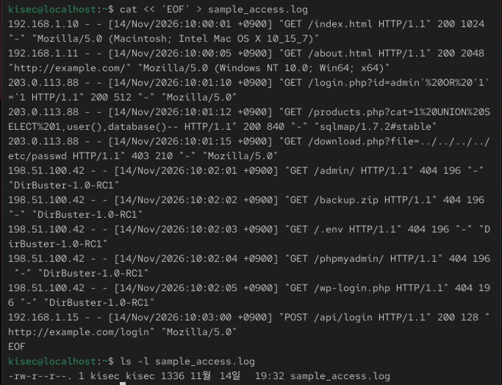
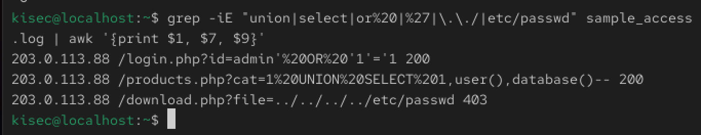
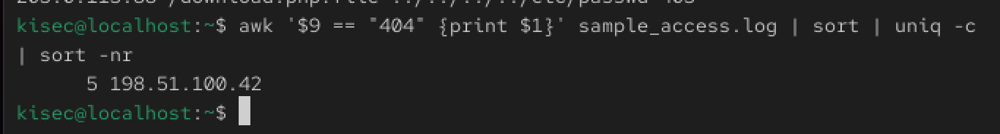
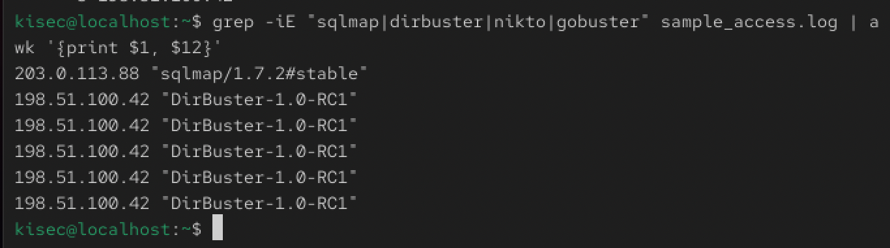

# 웹 서버 접근 로그(access.log) 기반 SQL 인젝션 및 웹 스캐닝 공격 탐지 실습

## 1. 실습 목적

* 웹 서버 로그 구조 이해 : Apache/Nginx 표준 Combined Log Format(결합 로그 형식)의 필드 구조와 HTTP 상태 코드(200, 403, 404)가 가진 보안적 의미를 파악.

<br>

* CLI 기반 위협 탐지 역량 강화 : GUI 분석 도구 없이 Linux 기본 명령어(`grep`, `awk`, `sort`, `uniq`)를 활용한 빠르고 효율적인 로그 파싱 및 탐지 파이프라인 구축

<br>

* 주요 웹 해킹 시그니처 식별 : 
  - URL 파라미터를 통한 SQL 인젝션(SQLi) 및 경로 탐색(Path Traversal) 공격 탐지
  - 단일 IP의 반복적인 404 에러 유발을 통한 웹 디렉토리 스캐닝(Reconnaissance) 행위 식별
  - 자동화 공격 툴(sqlmap, DirBuster 등)의 User-Agent 시그니처 분석


<br>


## 2. 실습 환경 구성

* 가상 웹 접근 로그(sample_access.log) 생성




<br>


## 3. 주요 실습 내용

1. SQL 인젝션(SQLi) 및 경로 탐색(Directory Traversal) 탐지

* 공격자들이 URL 파라미터에 자주 넣는 키워드(UNION, SELECT, OR, ../, etc/passwd)를 정규표현식(grep -iE)으로 한 번에 잡아내기

```bash
# -i : 대소문자 무시(union, UNION 모두 탐지)
# -E : 확장 정규표현식 (| 로 여러 패턴 동시 검색)

grep -iE "union|select|or%20|%27|\.\./|etc/passwd" sample_access.log | awk '{print $1, $7, $9}'
```

<br>




* 단일 IP(203.0.113.88)로부터 인증 우회형 SQLi, 데이터베이스 정보 추출형 SQLi, 그리고 시스템 파일 탈취 목적의 경로 탐색(Path Traversal) 공격이 연속적으로 발생한 것을 CLI 파이프라인으로 탐지함. 
* 특히 대부분의 공격이 HTTP 200 또는 403 코드를 유발한 것으로 보아, 시스템 방어 정책 점검 및 웹 방화벽(WAF) 룰셋 강화가 필요함을 확인함.


<br>
<br>


2. 웹 디렉토리 스캐닝(404 Not Found 폭주) 탐지

* 공격자가 숨겨진 관리자 페이지나 백업 파일을 찾기 위해 자동화 툴을 돌리면, 짧은 시간에 존재하지 않는 경로를 찌르면서 404 에러가 대량 발생.

```bash
# 9번째 필드(상태 코드)가 404인 줄만 골라내어, 그 줄의 IP주소를 뽑아낸 후 각 IP($1)별 발생 횟수를 집계.

awk '$9 == "404" {print $1}' sample_access.log | sort | uniq -c | sort -nr
```


* 실습 결과 : 5 198.51.100.42가 출력되며, 해당 IP가 집중적으로 존재하지 않는 경로를 스캐닝, 5번의 404 에러를 발생시켰음을 확인.


<br>
<br>


3. 악성 공격 도구(User-Agent) 시그니처 탐지

* 로그 전체에서 유명한 웹 취약점 스캐너 및 자동화 공격 툴의 시그니처 이름들을 골라내어 탐지

```bash
# 웹 취약점 스캐너 및 자동화 공격 툴의 시그니처 이름(sqlmap, DirBuster, Nikto, Gobuster)이 포함된 줄을 대소문자 구분 없이(-i) 골라냄.
# 골라낸 줄에서 접속자 IP 주소($1)와 브라우저/툴 정보를 담고 있는 User-Agent 영역($12 등)을 뽑아냄.

grep -iE "sqlmap|dirbuster|nikto|gobuster" sample_access.log | awk '{print $1, $12}'
```



* 실습 결과 : sqlmap(자동화 SQL 인젝션 툴)이나 DirBuster(디렉토리 무차별 대입 스캐닝 툴) 같은 공격 도구 고유의 이름이 로그에 찍힌 것을 확인. 공격자가 자신의 신분(사용 중인 툴)을 숨기지 않고 무단으로 웹 서버를 스캔했음을 확인.


<br>
<br>


## 4. 결론 및 대응 방안

1. 공격자 IP 방화벽 차단 :
   - 악성 행위가 식별된 IP에 대해 시스템 방화벽 또는 웹 방화벽(WAF)을 통한 접근 차단 조치 수행이 필요.

2. 웹 애플리케이션 보안 강화 :
   - SQL 인젝션 방지를 위해 동적 쿼리 대신, 안전한 방식인 Prepared Statement(매개변수화된 쿼리) 적용이 필요.
   - 파일 다운로드 기능 구현 시 상위 디렉토리 참조 문자(`../`) 필터링 로직 구현이 필요.

3. 모니터링 체계 고도화 :
   - 단시간 내 다수의 404 에러나 특정 스캐닝 툴이 유입될 경우 보안관제 시스템 경보 연동 필요

