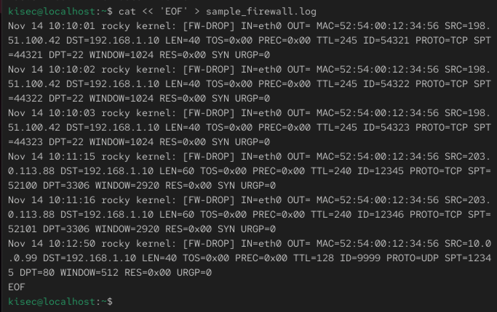
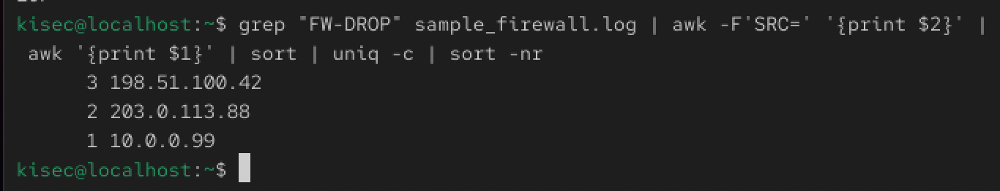
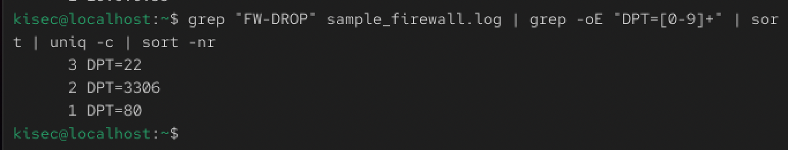

# 방화벽(Firewall) 및 IDS 차단 로그 기반 네트워크 침해 시도 탐지 분석

## 1. 실습 목적

* 방화벽 로그 구조 이해 : 리눅스 커널 방화벽(`firewalld`/`iptables`)의 패킷 차단 로그(`[FW-DROP]`)와 `Key=Value` 형태의 필드 구조 파악

* CLI 기반 정밀 파싱 역량 강화 : 공백 기반의 일반 로그와 달리 `SRC=`, `DPT=` 등 키-값 형태로 구성된 네트워크 로그에서 `awk -F` 옵션과 정규표현식(`grep -oE`)을 활용해 핵심 데이터만 추출하는 기법 습득

* 네트워크 침해 시도 식별 : 출발지 IP 빈도수와 목적지 포트(`DPT`) 분석을 통해 공격자의 주요 타겟 서비스(SSH, DB 등)와 스캐닝 정황 파악

## 2. 실습 환경 구성

* 가상 방화벽 차단 로그('sample_firewall.log') 생성



<br>


## 3. 주요 실습 내용

1. 차단된 공격자 IP(출발지) 빈도수 집계하기

```bash
# 방화벽에 가장 많이 차단당한 IP가 누구인지 확인하는 명령어

grep "FW-DROP" sample_firewall.log | awk -F'SRC=' '{print $2}' | awk '{print $1}' | sort | uniq -c | sort -nr
```

* grep "FW-DROP" sample_firewall.log : 로그 파일 전체에서 방화벽이 패킷을 차단했다는 핵심 표식인 [FW-DROP]이 포함된 줄만 골라냄. (정상 통신 로그는 걸러냄)

* awk -F'SRC=' "{print $2}" : -F'SRC=' 옵션은 SRC=라는 글자를 기준으로 문장을 쪼갬

* awk "{print \$1}" : 앞서 쪼개서 얻은 \$2 덩어리(198.51.100.42 DST=...)를 이번에는 공백(Space)을 기준으로 다시 쪼갬, 그중 첫 번째 칸($1)을 출력하므로, 뒤에 붙어있던 'DST=' 같은 불필요한 글자는 떨어져 나가고 오직 순수한 IP 주소(198.51.100.42)만 남김.

* sort | uniq -c | sort -nr : 추출된 IP들을 모아서 정렬(sort)하고, 똑같은 IP끼리 묶어서 개수(-c)를 센 뒤, 가장 많이 차단당한 IP가 맨 위로 오도록 역순으로 내림차순 정렬.




* 분석 결과 : `198.51.100.42`(3회), `203.0.113.88`(2회), `10.0.0.99`(1회) 순으로 차단 이력이 집계됨. 특히 `198.51.100.42` IP로부터 가장 빈번한 비정상 접근 시도가 발생하여 우선 차단 및 모니터링 대상으로 식별함.

<br>

2. 공격자들이 노린 타겟 서비스 포트(DPT) 분석하기

```bash
# 공격자들이 우리 서버의 어떤 포트(예: 22번 SSH, 3306번 DB 등)를 집중적으로 노렸는지 파악하는 명령어

grep "FW-DROP" sample_firewall.log | grep -oE "DPT=[0-9]+" | sort | uniq -c | sort -nr
```

* grep -oE : -o 옵션은 줄 전체에서 일치하는 특정 패턴만 쏙 빼내서 출력하라는 뜻, -E는 확장 정규표현식을 쓰겠다는 뜻.

* "DPT=[0-9]+" : DPT= 글자 뒤에 숫자가 한 개 이상([0-9]+) 붙어 있는 패턴(예: DPT=22, DPT=3306)을 찾아서 그 덩어리만 통째로 추출.



* 분석 결과 : `DPT=22`(SSH 원격 접속 포트, 3회), `DPT=3306`(MySQL DB 포트, 2회), `DPT=80`(웹 포트, 1회) 순으로 차단됨. 공격자들이 서버 관리자 권한 탈취(SSH) 및 데이터베이스 직접 접근(3306)을 주요 타겟으로 삼고 있음을 확인함.

<br>

## 4. 결론 및 대응 방안

1. 주요 서비스 포트 접근 통제 강화 :
   - 공격 집중 타겟으로 확인된 SSH(`22`) 및 DB(`3306`) 포트는 외부 전체(Any) 개방을 차단하고, 관리자의 특정 IP 대역에서만 접속할 수 있도록 방화벽 화이트리스트 정책 적용이 필요.

2. 상습 차단 IP 영구 블랙리스트 등록 :
   - 단시간 내 반복적으로 `FW-DROP` 로그를 유발하는 공격자 IP(`198.51.100.42` 등)를 식별하여 영구 차단 리스트에 등록 조치 필요.

3. 포트 변경 및 기본 보안 설정 강화 :
   - 외부 스캐닝 툴의 무차별 대입 공격을 회피하기 위해 SSH 기본 포트(`22`)를 비표준 포트로 변경하고, root 계정 직접 원격 로그인 제한 설정 적용이 필요.


