# Python 기반 보안 로그 분석 자동화 및 이상행위 탐지 실습


## 1. 실습 목적

* 본 실습은 Python을 활용하여 Linux 및 웹 서버의 보안 로그를 자동으로 분석하고, 비정상적인 접근 패턴과 반복적인 인증 실패 등의 이상행위를 탐지하는 것을 목적으로 한다. 로그 데이터에서 주요 정보를 추출하고 IP별 이벤트 발생 횟수를 집계하며, 분석 결과를 자동으로 보고서화하는 프로그램을 구현함으로써 보안 로그 분석 능력과 업무 자동화 역량을 향상시키고자 한다.


<br>
<br>


## 2. 세부 학습 목표

1. Python을 이용해 로그 파일을 읽고 처리하는 방법을 익힌다.
2. 정규표현식으로 IP 주소, 시간, 이벤트 유형 등을 추출한다.
3. IP 주소별 로그인 실패 횟수와 접근 기록을 자동 집계한다.
4. SQL Injection 의심 요청 및 비정상적인 접근 패턴을 탐지한다.
5. 분석 결과를 텍스트 보고서로 자동 생성한다.
6. 최종 구현 목표 : 로그 분석 자동화 프로그램
* 로그 파일 입력 -> Python 자동 분석 -> 분석 결과 보고서 생성

<br>

7. 최종 결과물

* analyze_logs.py — 로그 분석 프로그램
* correlation_secure.log — SSH 인증 로그
* correlation_access.log — 웹 접근 로그
* report.txt — 자동 생성된 분석 보고서


<br>
<br>


## 3. 실습 환경 구성

* 가상 SSH 로그 파일 생성 (correlation_access.log) 

```bash
cat << 'EOF' > correlation_access.log
203.0.113.88 - - [24/Nov/2026:21:11:01 +0900] "GET /login.php?id=1%27%20OR%20%271%27=%271 HTTP/1.1" 403 512 "-" "sqlmap/1.8"
203.0.113.88 - - [24/Nov/2026:21:11:10 +0900] "GET /search.php?id=1 UNION SELECT username,password FROM users HTTP/1.1" 403 512 "-" "sqlmap/1.8"
198.51.100.42 - - [24/Nov/2026:21:13:01 +0900] "GET /admin HTTP/1.1" 404 210 "-" "DirBuster"
198.51.100.42 - - [24/Nov/2026:21:13:05 +0900] "GET /backup.zip HTTP/1.1" 404 210 "-" "DirBuster"
198.51.100.42 - - [24/Nov/2026:21:13:10 +0900] "GET /.env HTTP/1.1" 404 210 "-" "DirBuster"
192.0.2.50 - - [24/Nov/2026:21:15:35 +0900] "GET /index.html HTTP/1.1" 200 1024 "-" "Mozilla/5.0"
192.0.2.50 - - [24/Nov/2026:21:15:40 +0900] "GET /about.html HTTP/1.1" 200 850 "-" "Mozilla/5.0"
EOF
```

<br>

* 가상 Web 로그 파일 생성

```bash
cat > correlation_secure.log << 'EOF'
Nov 24 21:10:01 server sshd[1024]: Failed password for invalid user admin from 203.0.113.88 port 51234 ssh2
Nov 24 21:10:02 server sshd[1025]: Failed password for root from 203.0.113.88 port 51235 ssh2
Nov 24 21:10:03 server sshd[1026]: Failed password for invalid user test from 203.0.113.88 port 51236 ssh2
Nov 24 21:12:01 server sshd[1030]: Failed password for root from 198.51.100.42 port 52341 ssh2
Nov 24 21:12:05 server sshd[1031]: Failed password for admin from 198.51.100.42 port 52342 ssh2
Nov 24 21:15:30 server sshd[1040]: Accepted password for user from 192.0.2.50 port 53421 ssh2
EOF
```

<br>
<br>


## 4. 주요 학습 내용 및 실습

1. SSH 로그인 실패 기록 추출 프로그램

* 핵심 코드 

```bash
if "Failed password" in line:
```


<br>

* 전체 코드

```bash
log_file = "correlation_secure.log"

with open(log_file, "r") as file:
    logs = file.readlines()

print("===== SSH Login Failure Analysis =====")

failed_count = 0

for line in logs:
    if "Failed password" in line:
        print(line.strip())
        failed_count += 1

print("--------------------------------------")
print("Failed Login Count:", failed_count)
print("===== Analysis Complete =====")
```

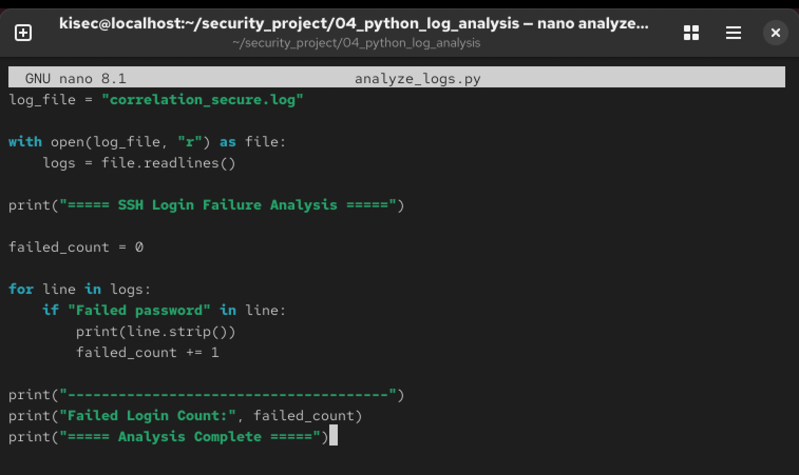

<br>

* 실행 결과
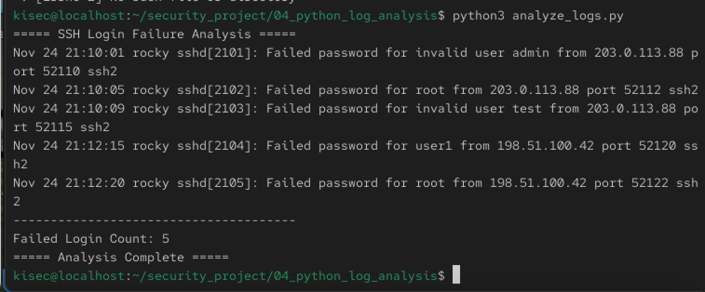

* 총 5건의 로그인 실패 기록 추출


<br>


2. 정규표현식(re모듈)을 이용한 IP주소 자동 추출 프로그램

* re 모듈 : 정규표현식을 사용해서 문자열에서 원한느 패턴을 찾을 수 있게 해줌


* 핵심코드

```bash
match = re.search(r"from (\d+\.\d+\.\d+\.\d+)", line)
```

* 전체 코드

```bash
import re

log_file = "correlation_secure.log"

with open(log_file, "r") as file:
    logs = file.readlines()

print("===== SSH Login Failure IP Analysis =====")

failed_count = 0

for line in logs:
    if "Failed password" in line:
        match = re.search(r"from (\d+\.\d+\.\d+\.\d+)", line)

        if match:
            ip = match.group(1)
            print("Detected IP:", ip)
            failed_count += 1

print("-----------------------------------------")
print("Failed Login Count:", failed_count)
print("===== Analysis Complete =====")
```

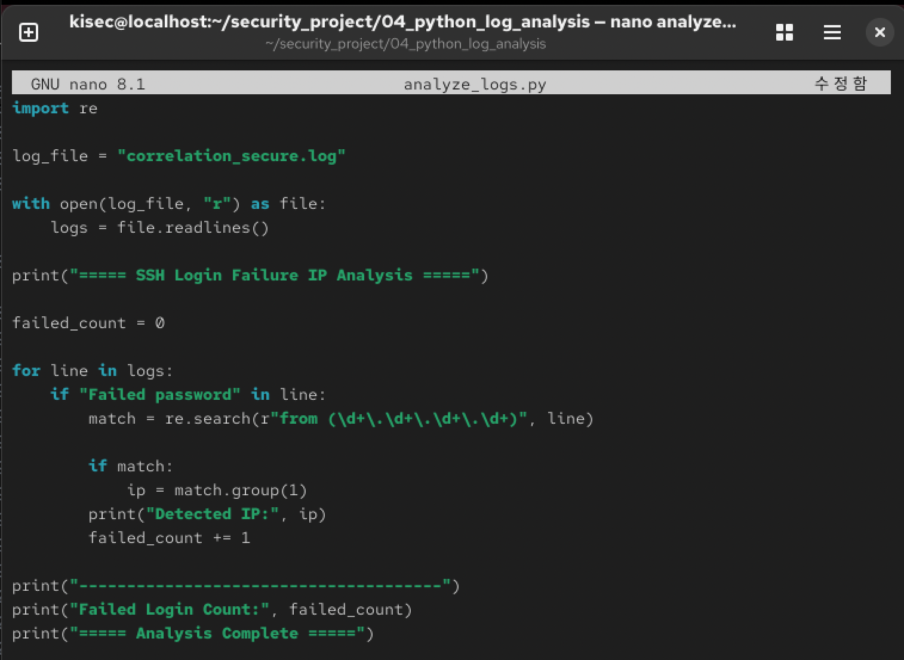

* 실행 결과

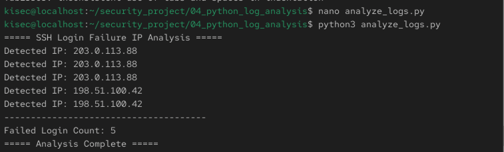


<br>
<br>

3. counter 기능을 사용한 IP 주소별 로그인 실패 횟수 집계

* 핵심 코드

```bash
# counter

from collections import Counter
ip_counts = Counter()
```

<br>


* 전체 코드

```bash
import re
from collections import Counter

log_file = "correlation_secure.log"

with open(log_file, "r") as file:
    logs = file.readlines()

ip_counts = Counter()

for line in logs:
    if "Failed password" in line:
        match = re.search(r"from (\d+\.\d+\.\d+\.\d+)", line)

        if match:
            ip = match.group(1)
            ip_counts[ip] += 1

print("===== IP Login Failure Statistics =====")

for ip, count in ip_counts.most_common():
    print(f"{ip}: {count} times")

print("---------------------------------------")
print("Total Failed Logins:", sum(ip_counts.values()))
print("===== Analysis Complete =====")
```

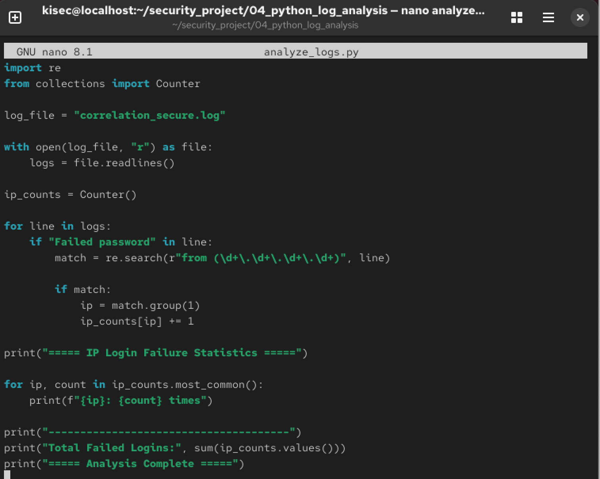


<br>

* 실행 결과

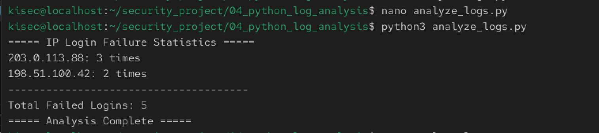


<br>


4. 이상행위 탐지 기능 

* 집계한 결과를 이용해서 특정 기준 이상으로 로그인에 실패한 IP를 분류

* 이번 실습에서는 기준을 로그인 실패 3회 이상으로 설정

```bash
import re
from collections import Counter

log_file = "correlation_secure.log"

with open(log_file, "r") as file:
    logs = file.readlines()

ip_counts = Counter()

for line in logs:
    if "Failed password" in line:
        match = re.search(r"from (\d+\.\d+\.\d+\.\d+)", line)

        if match:
            ip = match.group(1)
            ip_counts[ip] += 1

print("===== Security Threat Detection =====")

for ip, count in ip_counts.most_common():
    if count >= 3:
        print(f"[WARNING] {ip}: {count} failed logins")
    else:
        print(f"[NORMAL] {ip}: {count} failed logins")

print("=====================================")
print("Total Failed Logins:", sum(ip_counts.values()))
print("===== Analysis Complete =====")
```

<br>

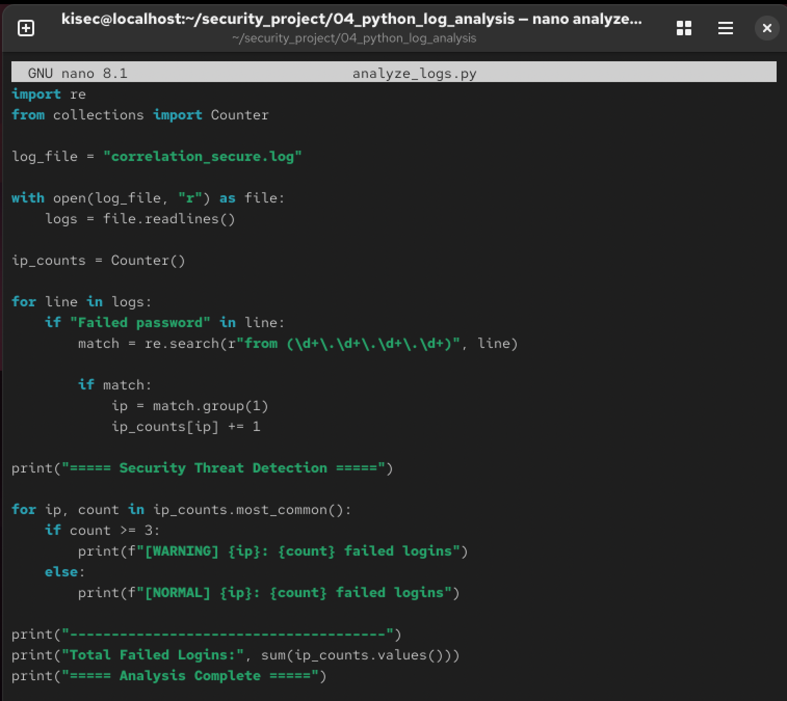

<br>

* 핵심 코드

```bash
# 로그인 실패 횟수가 3회 이상인지 검사하는 조건 추가

if count >= 3:
```

<br>

* 실행 결과

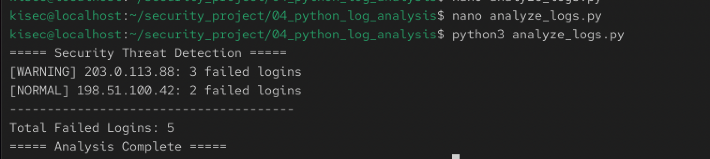

<br>
<br>


5. SSH 로그 분석 결과를 보고서 파일로 자동 저장하기

* 분석 결과를 report.txt로 자동 생성

```bash

import re
from collections import Counter
from datetime import datetime

log_file = "correlation_secure.log"

with open(log_file, "r") as file:
    logs = file.readlines()

ip_counts = Counter()

for line in logs:
    if "Failed password" in line:
        match = re.search(r"from (\d+\.\d+\.\d+\.\d+)", line)

        if match:
            ip = match.group(1)
            ip_counts[ip] += 1

total_failed = sum(ip_counts.values())

report = []

report.append("===== Security Log Analysis Report =====")
report.append("Generated: " + datetime.now().strftime("%Y-%m-%d %H:%M:%S"))
report.append("")
report.append("Total Failed Logins: " + str(total_failed))
report.append("")
report.append("===== IP Statistics =====")

for ip, count in ip_counts.most_common():
    if count >= 3:
        status = "WARNING"
    else:
        status = "BELOW THRESHOLD"

    report.append(f"[{status}] {ip}: {count} failed logins")

report.append("")
report.append("===== Analysis Complete =====")

with open("report.txt", "w") as file:
    file.write("\n".join(report))

print("Analysis complete.")
print("Report saved to report.txt")

```

<br>

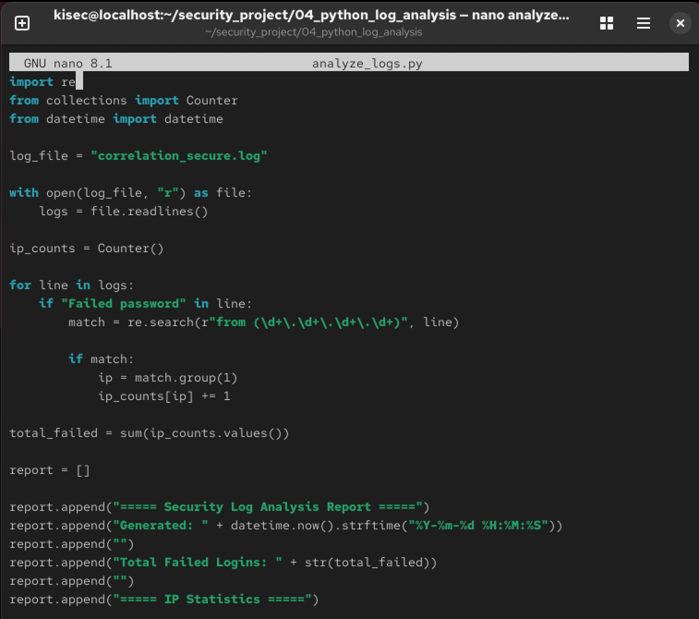
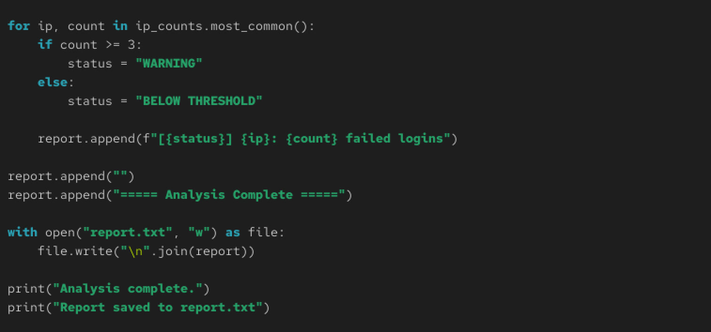

* 핵심 코드

```bash
# report 라는 리스트에 보고서 문장을 하나씩 추가

report = []
report.append("내용")
```

```bash
# w : 파일에 입력(write) 모드로 열기
# "\n".join(report) : 리스트에 있는 문장들을 줄바꿈으로 연결
# file.write() : 연결된 내용을 파일에 기록

with open("report.txt", "w") as file:
    file.write("\n".join(report))
```

<br>


* 실행 후 cat으로 report.txt 파일 내용 확인 결과

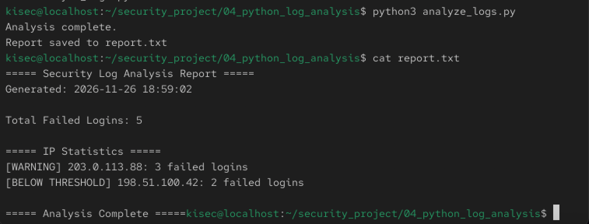


<br>
<br>

6. 웹 로그 분석 기능 추가

* SSH 인증 로그와 웹 접근 로그를 자동 분석하고, 탐지 결과를 보고서로 저장

```bash
import re
from collections import Counter
from datetime import datetime

# Read SSH log
with open("correlation_secure.log", "r") as file:
    secure_logs = file.readlines()

# Read Web access log
with open("correlation_access.log", "r") as file:
    access_logs = file.readlines()

ssh_ip_counts = Counter()
web_ip_counts = Counter()

failed_count = 0
sqli_count = 0
not_found_count = 0

# Analyze SSH logs
for line in secure_logs:
    if "Failed password" in line:
        failed_count += 1
        match = re.search(r"from (\d+\.\d+\.\d+\.\d+)", line)

        if match:
            ssh_ip_counts[match.group(1)] += 1

# Analyze Web logs
for line in access_logs:
    match = re.search(r"^(\d+\.\d+\.\d+\.\d+)", line)

    if match:
        ip = match.group(1)
        web_ip_counts[ip] += 1

    if "UNION SELECT" in line.upper() or "OR 1=1" in line.upper():
        sqli_count += 1

    if '" 404 ' in line:
        not_found_count += 1

# Create report
report = []

report.append("===== Security Log Analysis Report =====")
report.append("Generated: " + datetime.now().strftime("%Y-%m-%d %H:%M:%S"))
report.append("")

report.append("===== SSH Analysis =====")
report.append("Total Failed Logins: " + str(failed_count))

for ip, count in ssh_ip_counts.most_common():
    status = "WARNING" if count >= 3 else "BELOW THRESHOLD"
    report.append(f"[{status}] {ip}: {count} failed logins")

report.append("")
report.append("===== Web Access Analysis =====")
report.append("Total Web Requests: " + str(sum(web_ip_counts.values())))
report.append("SQL Injection Suspicious Requests: " + str(sqli_count))
report.append("404 Not Found Responses: " + str(not_found_count))

report.append("")
report.append("===== Web IP Statistics =====")

for ip, count in web_ip_counts.most_common():
    report.append(f"{ip}: {count} requests")

report.append("")
report.append("===== Analysis Complete =====")

with open("report.txt", "w") as file:
    file.write("\n".join(report))

print("Analysis complete.")
print("Report saved to report.txt")
```

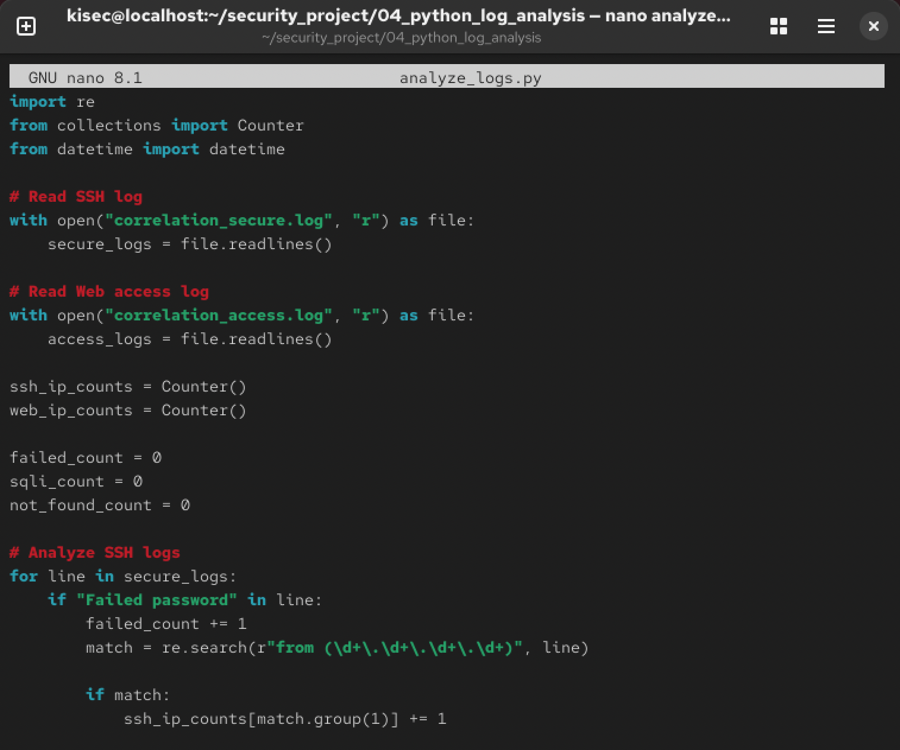
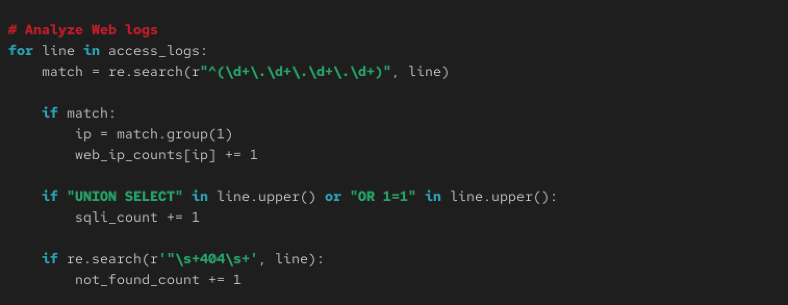
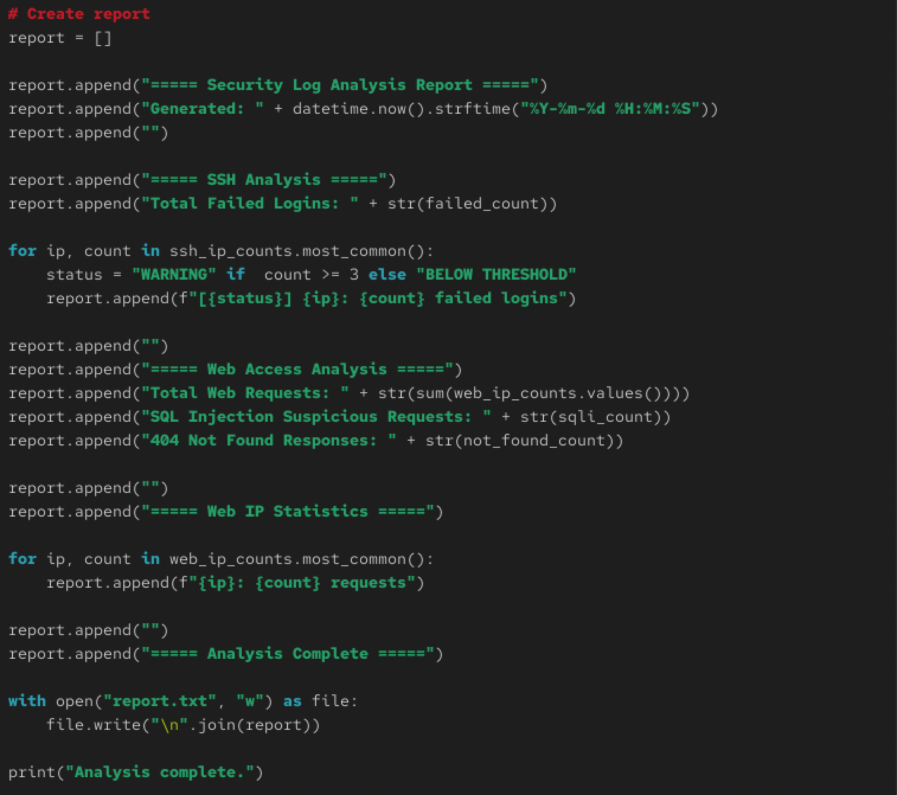

<br>

* 핵심 코드

```bash
# IP별 SSH 로그인 실패 횟수
ssh_ip_counts = Counter()

# IP별 Web 요청 횟수
web_ip_counts = Counter()


# 전체 SSH 로그인 실패 횟수
failed_count = 0

# SQL Injection 의심 요청 횟수
sqli_count = 0

# 404 오류 횟수
not_found_count = 0
```

<br>

```bash
# Web 접근 로그 분석
# 웹 로그의 맨 앞에 있는 IP 주소를 추출하고, IP별 요청 횟수를 계산

for line in access_logs:
    match = re.search(r"^(\d+\.\d+\.\d+\.\d+)", line)

    if match:
        ip = match.group(1)
        web_ip_counts[ip] += 1
```

```bash
# SQL Injection 의심 패턴 탐지

if "UNION SELECT" in line.upper() or "OR 1=1" in line.upper():
    sqli_count += 1
```

```bash
# 404 오류 탐지

if re.search(r'"\s+404\s+', line):
    not_found_count += 1
```

<br>
<br>

* 실행 후 cat으로 report.txt 파일 내용 확인 결과

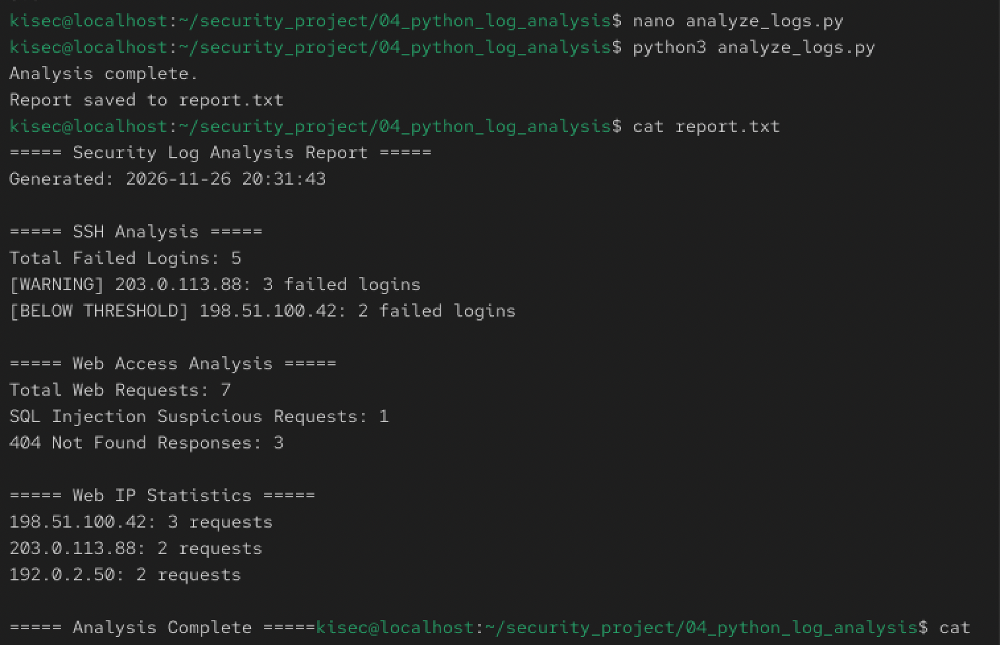


<br>
<br>

## 5. 결론 및 실습 내용 요약

* Python의 정규표현식과 Counter 모듈을 활용하여 SSH 인증 로그와 웹 접근 로그를 자동 분석하였다. 
* SSH 로그에서는 반복적인 로그인 실패와 IP별 발생 횟수를 집계하고, 웹 로그에서는 SQL Injection 의심 패턴과 HTTP 404 응답을 탐지하였다. 
* 최종적으로 분석 결과를 텍스트 파일로 자동 생성하도록 구현하였다.